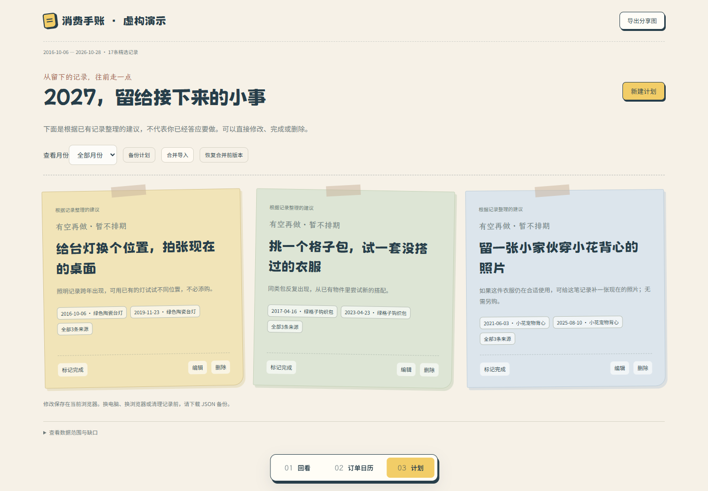

<h1 align="center">电商消费手帐</h1>
<p align="center">从买过的东西，翻回生活的不同阶段。</p>
<p align="center"><strong>Agent Skill</strong> · 真实订单 · 消费回看 · 本地离线</p>
<p align="center">
  <a href="#快速开始">快速开始</a> ·
  <a href="#拼贴手账的样子">效果预览</a> ·
  <a href="SKILL.md">查看 Skill</a> ·
  <a href="https://github.com/fly-YaoPro/taobao-consumption-journal/archive/refs/heads/main.zip">下载完整包</a>
</p>

<p align="center">
  
</p>
<p align="center"><sub>包内框架的实际渲染截图。人设、订单与日期为虚构演示，商品画面由 AI 生成；不是真实账号采集结果。正式制作使用订单对应的真实平台图片。<a href="assets/showcase/provenance.json">素材说明</a></sub></p>

> 一套由 Agent 执行的完整流程：**采集成功订单与真实商品图 → 梳理生活阶段与物件故事 → 制作回看、订单日历和计划**。包含可运行的页面框架、本地字体、采集规则与检查工具，无需自己搭建网页。

**本版使用通用名称「电商消费手帐」，保留纸页手账框架与完整制作流程。** 入口先识别订单平台，目前仅支持淘宝；京东、拼多多、抖音电商、亚马逊等其他平台会直接返回“该平台暂不支持”，已有这些平台的导出也不例外。本轮仅调整 Skill 名称、简介和平台路由说明，不更换采集代码、版式、商品图规则或隐私筛选，也保留真实模板构建、浏览器导出 PNG 与终稿检查的回归。从仓库首页安装且未指定版本时，获取的是 `main` 当前版本；旧安装需主动更新，固定历史版本见[版本与回退](#版本与回退)。

仓库地址继续沿用 `taobao-consumption-journal`，安装后的 Skill 名称与文件夹统一为 `ecommerce-consumption-journal`。多平台识别仅用于正确接受或拒绝任务，不等于多平台采集已经实现。

## 不只是一张消费总额

| 消费回看 | 订单日历 | 后续计划 |
| --- | --- | --- |
| 沿时间回看购买重心与生活变化，穿插具体物件、持续兴趣和消费反差。 | 点日期翻订单、看真实商品图，跨年份搜索和筛选。 | 先根据记录生成具体建议，再按月修改、打卡、备份与恢复。 |

总结短一点，证据留得住。买过不等于用过、喜欢或给自己买；没有依据的生活经历，不替用户编。

## 拼贴手账的样子

### 从几件东西，翻回一段日子

首页先铺开物件与短回顾，再沿有依据的购买变化展开。实物、照片、书影音封面、设计预览与服务订单分别处理；文字密集的卖货图留在原图入口，不放大套相纸。内容先挑不同发现，不按年份硬分阶段，不在主题、阶段与跨年区反复讲同一件事。

**阶段纸页 · 点标签，翻一段日子**


一个标签对应一段时期：代表商品放在主纸页，具体线索放在侧笺。点击标签、前后按钮或方向键翻阅，纸页轻滑进入；内容高度随文字展开。奶油纸底、墨蓝文字和少量玉米黄点题，正文与短便签各用适合的字体。

### 回看之后，还能继续用

<table>
  <tr>
    <td width="50%" valign="top">
      <h4>订单日历 · 点开那一天</h4>
      <a href="assets/showcase/preview-calendar.png"></a>
      <p>有记录的日期带商品缩略图，点开看当天订单；支持跨年搜索与品类筛选。</p>
    </td>
    <td width="50%" valign="top">
      <h4>后续计划 · 先有建议，再自己改</h4>
      <a href="assets/showcase/preview-plans.png"></a>
      <p>Agent 先根据具体发现提出建议，不交付空页，也不逐类目套整理任务。无日期依据可暂不排期，之后自行修改、打卡与备份。</p>
    </td>
  </tr>
</table>

### 分享图也保留物件

<p align="center"><a href="assets/showcase/preview-share.png"></a></p>

大标题、商品拼贴、短注与少量发现，先预览再下载，不是纯文字报告。正式使用带对应真实商品图，图片嵌入离线资源，无需外链加载；账号、地址和订单号不放进画面。

以上五张图来自同一套虚构演示数据，展示包内代码的实际版式。图片可点开看大图；真实采集、金额核对与账号权限仍需在使用时验证。

<details>
<summary>页面里还有什么</summary>

1. **大标题与旧物拼贴**：按类型处理的真实素材、短回顾、具体发现。
2. **记得住的物件**：选几件有故事的东西，点开看单图、对照或来源小票。
3. **人生阶段纸质档案**：有真实变化才分段，不按年份凑数；点标签翻阅，主物、对照和条目采用不同图文比。
4. **跨年线索**：看看持续了什么、变化了什么，有依据才展开。
5. **配歌与下一步**：可选的歌曲推荐，以及从真实记录整理出的计划。

始终保留 **回看 / 订单日历 / 计划** 三个入口。页面框架、字体、标题断句、纸页切换和手机重排已写入包内代码；Agent负责分析资料与填充内容。见[人生阶段拼贴框架](references/scrapbook-blueprint.md)。

</details>

<details>
<summary>展开查看虚构视觉参考图（早期风格示意，非新版运行截图）</summary>

以下图片为 AI 生成的虚构设计示意，仅用于理解配色、纸层与物件组合；当前页面结构以包内框架为准。


</details>

**借的是版式，不是示例里的购买记录。** 实际制作时，商品必须换成真实订单对应的平台图片。缺图不生成，相似商品也不能补位。

## 快速开始

### 让 Agent 安装

把这段发给支持本地 Skill 安装的 Agent：

```text
请从这个仓库的 main 分支安装最新版本：
https://github.com/fly-YaoPro/taobao-consumption-journal

按当前客户端的 Skill 安装规范，将 Skill 文件夹命名为 ecommerce-consumption-journal，完整保留 SKILL.md、
references、assets 和 scripts。安装后核对提交版本，
不要在安装过程中读取订单或生成手账。
```

也可以[下载 main 完整包](https://github.com/fly-YaoPro/taobao-consumption-journal/archive/refs/heads/main.zip)，解压后将包含 `SKILL.md` 的完整文件夹重命名为 `ecommerce-consumption-journal`，再放入客户端规定的 Skill 目录。不同客户端的安装与加载入口可能不同；不要只复制 `SKILL.md`，页面、字体和脚本也需要保留。

Agent需要文件读写、代码执行和本地读图能力；在线采集还需要浏览器操作能力。也支持用户提供的合法订单导出与真实商品图片。

### 安装后开始使用

```text
使用 $ecommerce-consumption-journal（电商消费手帐），帮我回看近十年的淘宝成功订单。
我来登录，你先核验能读取的日期范围和几笔订单。
沿时间梳理购买重心和生活变化，穿插记得住的物件与兴趣，
用 Skill 自带的人生阶段拼贴框架制作。商品图必须真实对应订单。
要能按日历翻订单、搜索旧记录，并先生成几条我能自己改的计划。
```

已有数据时可以直接说“不要重采，用这些订单和图片制作”。只要改页面时，应保留原始订单、来源与手动计划。见[调用示例](references/usage.md)。

### 更新已安装的旧版

已安装的 Skill 不保证自动更新，可以直接这样要求：

```text
将已安装的电商消费手帐更新到这个仓库 main 分支的最新版本：
https://github.com/fly-YaoPro/taobao-consumption-journal

新 Skill 名称和文件夹是 ecommerce-consumption-journal。
如果旧安装名为 taobao-consumption-journal，先识别旧安装位置，迁移到新名称，避免重复安装两份；
不要把用户数据目录当作 Skill 安装目录覆盖。
更新 Skill 代码和配套资源，核对提交版本。
保留我的订单、图片、已生成网页和手动计划，不自动重新采集或重做产物。
```

更新的是 Skill 本身，已有手账不会因此自动换版。需要用新版框架重做时，再明确提出；保留原始数据，并先备份手动计划。

## 先把账算清楚

| 容易混淆的地方 | 处理方式 |
| --- | --- |
| 一单多件商品 | 分别保存商品，总实付只在父订单层计一次。 |
| 退款与净支出 | 保留原金额标签，不把已经扣过退款的净额再扣一次。 |
| 读不到金额 | 保持未知，不用零代替，不拿商品标价充当实付。 |
| 只读到部分年份 | 明示实际覆盖，不用最近几十单外推十年。 |
| 商品推断经历 | 买护具不等于身体异常，买旅行用品不等于真的出行。 |

默认只纳入交易成功订单，排除未付款、取消和交易关闭。不同币种不直接相加，未知的商品级金额不随意均摊。

## 两条制作规则

**先看图，再做页面。** Agent 必须实际打开包内总览和主题参考图，理解配色、纸层、图文比例和留白，再与生成的页面截图对照。不能只读文件名，不能把参考图铺成网页背景。

**平台图片，真实对应。** 正式商品图只能来自实际订单、核对过商品及规格的对应商品页，或用户授权的同一商品实拍。允许抠图、缩放和白描边，不允许 AI 生成、卡通化或相似商品替换；装饰素材与证据图片分开保存。

## 工作方式

采集支持首屏即存、正常列表有界批次、断点缓存和商品图去重并发下载。减少重复读页与逐单详情往返，不缩小日期范围、不少下图片，也不替换图文叙事和页面框架。参见[采集方式](references/collection-fast-path.md)。宿主不支持预制DOM适配器时，仍可通过正常浏览器逐页整理；没有真实账号复测，不承诺固定完成时间。

```text
识别平台 → 淘宝：用户登录 / 提供导出 → 小样本核验 → 分批保存订单与图片
                                        ↓
                          金额与来源核对 → 消费回看
                                        ↓
                           看参考图 → 静态网页 → 实测交付

其他平台 → “该平台暂不支持”，结束，不调用采集或构建
```

时间范围与标题可自定，未指定时默认回溯十年。成本明显超出预期时先让用户选范围，不擅自抽样；中断有进度，后续可以补采。计划年份按任务确定，不绑定活动年份。

## 页面框架

采集或导入后，Agent先沿时间找购买重心的变化，归纳阶段；再补物件小事、兴趣延续、配套投入和具体反差，最后整理计划并构建网页。不能只算总额/类目就开始套页面，也不从商品擅自推断毕业、婚育、搬家等经历。确认过的背景才可入叙事。回顾、订单日历和计划使用同一份数据。

框架是完整流程中的页面实现环节，**不要求用户事先爬好订单或手写数据文件**。已有导出时也可单独导入制作。数据字段和构建方式见 [页面框架说明](references/implementation.md)。

## 版本与回退

- [仓库首页 · main](https://github.com/fly-YaoPro/taobao-consumption-journal)：默认安装入口，随之后的提交更新。
- [通用名称与平台路由版 · 2026-11-06](https://github.com/fly-YaoPro/taobao-consumption-journal/tree/generic-routing-20261106)：本次更新的固定版本。
- [更名前的完整旧版 · 2026-11-06](https://github.com/fly-YaoPro/taobao-consumption-journal/tree/backup-pre-generic-routing-20261106)：保留原名称、完整流程与全部资源，可随时取回。
- [终稿验收修复版 · 2026-11-04](https://github.com/fly-YaoPro/taobao-consumption-journal/tree/starter-final-check-20261104)：本次修复的固定标签，包含真实模板集成回归。
- [本次修复前的完整旧版](https://github.com/fly-YaoPro/taobao-consumption-journal/tree/codex/before-starter-final-check-20261104)：保留修复前全部文件。
- [纸页手账版 · 2026-11-03](https://github.com/fly-YaoPro/taobao-consumption-journal/tree/codex/paper-keepsake-20261103)：上一版完整框架。
- [纸页改版前的完整旧版](https://github.com/fly-YaoPro/taobao-consumption-journal/tree/codex/before-paper-keepsake-20261103)：更早一代备份，可直接查看或下载。
- [图文叙事与分类素材版 · editorial-media-20261031](https://github.com/fly-YaoPro/taobao-consumption-journal/tree/editorial-media-20261031)：此次更新的固定版本，含商品拼贴分享。
- [本次更新前 · before-editorial-media-20261031](https://github.com/fly-YaoPro/taobao-consumption-journal/tree/before-editorial-media-20261031)：保留本次修改前的完整版本。
- [上一代人生阶段框架 · life-stages-20261031](https://github.com/fly-YaoPro/taobao-consumption-journal/tree/life-stages-20261031)：早一代框架的固定版本。
- [更新前备份 · before-life-stages-20261031](https://github.com/fly-YaoPro/taobao-consumption-journal/tree/before-life-stages-20261031)：保留旧版完整内容。

版本分支与标签保留对应版本的完整文件，可随时查看或下载。要将默认版本改回旧版时，用新的恢复提交保留两版历史，不删除仓库、不强制覆盖提交记录。

## 本地检查

图片下载和页面显示分开核验：选入页面的图缺story.visuals映射会停止构建，不再默默变成文字来源卡；HTML/空响应不能当图片。有可展示商品图时首页必须实际有图，构建附media-report.json，仍要浏览器检查加载结果。

检查器使用 **Python 3.9+ 标准库**，不联网，不读取真实账号。

```bash
# 在 Skill 目录中运行；“项目目录”是生成的手账目录
python scripts/check_project.py "项目目录" --kind taobao --stage data
python scripts/check_project.py "项目目录" --kind taobao --stage final

# 合成数据回归测试
python -B scripts/test_check_project.py

# 模板集成回归：真实 starter 构建 → 离线页面下载 PNG → final 检查
# 需要测试环境安装 Playwright（npm install --no-save playwright），不影响成品零依赖。
node scripts/test_starter_integration.cjs --browser "本机Chrome路径" --artifacts "新的测试产物目录"
```

检查器会检查父订单 ID、金额格式、数量、状态、时间、图片路径和页面结构，但不能证明平台金额相符、真实图片无误或交互可用。仍要实测离线打开、搜索、日历、计划保存与导入恢复、PNG 下载，未测项必须说明。见 [验收清单](references/acceptance.md)。

集成测试保留 `integration-receipt.json`、截图与实际下载的 1080×1440 PNG，同时验证空 data 图标、外部脚本和缺失资源继续被拒绝。使用合成无图夹具，不把此回归当作真实账号采集或商品图片验收。

## 仓库结构

```text
SKILL.md          Agent 入口
agents/           可选的客户端展示信息
references/       采集、金额口径、内容、视觉与验收规则
assets/cases/     虚构视觉参考图
assets/showcase/  新版框架实装截图（虚构数据演示）
assets/starter/   可运行的离线拼贴页面框架
assets/provenance.json  参考图说明与校验值
scripts/          构建器、结构检查与合成数据测试
```

## 隐私与能力边界

成品交付末尾询问是否部署，默认推荐“部署上线”，但必须得到明确确认。豆包优先使用实际可用的妙搭，其他Agent列实际支持的发布方式；订单与图片的上传内容和访问范围先核对，不默认公开。详见[部署说明](references/deployment.md)。

订单是私有资料，只处理用户授权的账号。不读取聊天、地址、手机号或收件人，不下单、不支付、不改订单；登录和验证码由用户处理，不绕过限制。

默认将内衣、内裤、成人及私密健康商品排除在回顾、日历、搜索、分享图和可部署数据包之外，普通袜子不泛化排除。用户指定不展示的记录同样排除；原始资料仍留在本地，Agent负责重写受影响的叙事。自动规则辅助检查，仍需逐条、逐图复核。见[隐私筛选](references/privacy.md)。

交付是可离线浏览的 HTML/CSS/普通 JS 文件夹。原订单外链仍需要网络和权限；本地计划需验证浏览器兼容性，并提供 JSON 备份。分享图按用户要求使用真实商品图片，不包含无关账号、地址或订单号，不自动公开上传。

本公开仓库不含真实订单、Cookie、令牌或浏览器 profile。已做结构、链接、素材替换及离线合成数据检查，**不代表真实账号的端到端实测已通过**。

---

[作者：fly-YaoPro](https://github.com/fly-YaoPro) · [姊妹 Skill：社媒人生手帐](https://github.com/fly-YaoPro/weibo-life-archive)

本仓库未附加代码开源许可证；复用与再分发授权请先联系作者。包内字体单独适用随附的OFL许可，复制网页时保留字体署名与许可。平台图片和用户数据不因本仓库公开而获得再分发授权。

外部网站只用于一般设计研究，不作为逐项复刻对象。获取账号或图片访问权不等于有权公开再分发。具体执行见[设计与素材使用边界](references/design-rights.md)；规则调整不代表历史页面已通过设计相似性或法律审查。
